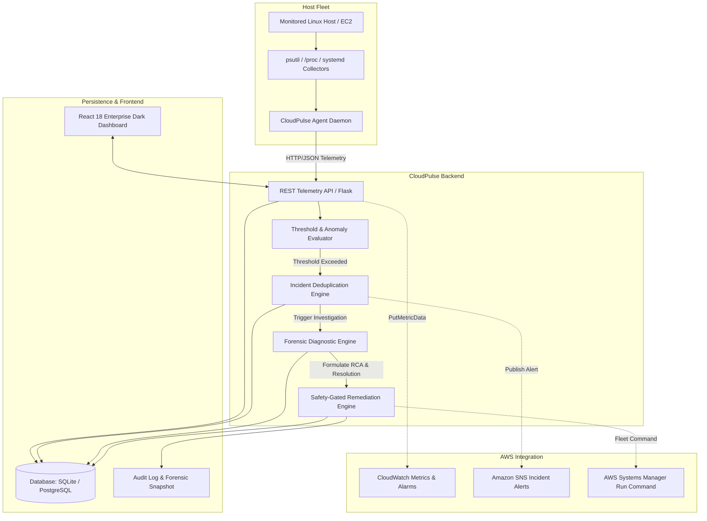

# CloudPulse: Intelligent Infrastructure Monitoring & Incident Response Platform

[](https://github.com/thejus07/CLOUDPULSE/actions)
[](LICENSE)
[](https://python.org)
[](https://react.dev)
[](https://aws.amazon.com)

> Built for enterprise production observability and designed to showcase practical **Linux Administration**, **Python Backend Engineering**, **AWS Cloud Architecture**, **Systems Troubleshooting**, and **Automated Incident Remediation** for an **Amazon Support Engineer Intern** portfolio.

---

## 1. Problem Statement

Modern enterprise cloud services cannot rely on manual diagnostic procedures during high-severity infrastructure outages. When a production Linux host experiences CPU saturation, memory exhaustion, disk bloat, or daemon crashes, engineers face:
1. **High Mean Time to Detect (MTTD)** due to fragmented monitoring tools.
2. **Elevated Mean Time to Recovery (MTTR)** while engineers manually SSH into instances to capture thread dumps, inspect `journalctl` logs, and hunt large files.
3. **Alert Fatigue** caused by duplicate alert storms for a single ongoing incident condition.
4. **Human Error & Security Risks** during emergency remediation.

**CloudPulse** solves these challenges by providing an end-to-end autonomous monitoring and incident response loop: it continuously collects telemetry, detects threshold breaches, generates deduplicated incident tickets, runs automated deep-dive diagnostic routines, isolates root causes, and executes verified, allowlisted remediations with post-check confirmation.

---

## 2. Architecture & Workflow



### End-to-End Incident Lifecycle
```
[1. DETECT]        Telemetry breaches threshold (e.g., Disk at 92.5%)
       │
[2. TICKET]        Deduplication engine generates/updates unique ticket (e.g., INC-20261116-3DAC)
       │
[3. INVESTIGATE]   Diagnostic Engine isolates large directories & files safely
       │
[4. RCA]           Formulates probable root cause & recommended action
       │
[5. REMEDIATE]     Safety-gated allowlisted recovery executed (CLEAN_TEMP_FILES)
       │
[6. VERIFY]        Post-check confirms file deleted & disk space reclaimed
       │
[7. RESOLVE]       Incident status updated to RESOLVED with full recovery audit trail
```

---

## 3. Technology Stack

- **Backend & Core Engine**: Python 3.11, Flask, SQLAlchemy, Pydantic, Gunicorn.
- **Monitoring & Operating Systems**: `psutil`, Linux `/proc` filesystem, `systemd` (`systemctl`), `journalctl`, `os.statvfs`.
- **Cloud & AWS**: AWS EC2, IMDSv2 token discovery, Amazon CloudWatch (`PutMetricData`), Amazon SNS, AWS Systems Manager (SSM), Boto3, IAM Roles.
- **Database**: SQLite (local development), PostgreSQL 15 (production/Docker).
- **Frontend Dashboard**: React 18, TypeScript, Tailwind CSS, Recharts, Lucide Icons, Vite.
- **DevOps & Infrastructure**: Docker, Docker Compose, GitHub Actions CI/CD, Terraform.
- **Testing**: Pytest, Pytest-Mock.

---

## 4. Key Modules & Features

### A. Autonomous Linux Monitoring Agent (`agent/`)
- Gathers CPU utilization (overall and per core), Unix load averages (`1m`, `5m`, `15m`), physical RAM and swap counters.
- Inspects mounted disk partitions and disk I/O rates.
- Collects network bytes sent/received, packet drops, and error rates.
- Tracks process lists and isolates top CPU and memory consumers safely using `psutil`.
- Tracks `systemd` unit states and parses `journalctl` error logs.
- Can run as a standalone CLI (`--once`) or a background daemon (`--daemon`).

### B. Independent Diagnostic Engine (`backend/app/diagnostics/`)
- `CPUDiagnostics`: Identifies runaway processes, captures PIDs, and analyzes core load balance.
- `MemoryDiagnostics`: Diagnoses RAM exhaustion, swap saturation, and OOM killer vulnerability.
- `DiskDiagnostics`: Safely scans filesystems with recursion limits, detects large directories and files, and monitors inode exhaustion.
- `ServiceDiagnostics`: Checks `systemctl` statuses and parses exit codes for port conflicts (`EADDRINUSE`) or crashes (`OOM`).
- `NetworkDiagnostics`: Measures DNS resolution latency, tests TCP socket handshakes, and verifies HTTP application endpoints.

### C. Incident Management Engine (`backend/app/services/incident_service.py`)
- Full lifecycle statuses: `DETECTED` $\rightarrow$ `INVESTIGATING` $\rightarrow$ `OPEN` $\rightarrow$ `RESOLVING` $\rightarrow$ `RESOLVED` $\rightarrow$ `ESCALATED`.
- Severity classification: `INFO`, `LOW`, `MEDIUM`, `HIGH`, `CRITICAL`.
- **Deduplication Engine**: Fingerprints alerts using `{server_id}:{alert_type}:{resource}` to prevent duplicate alert storms.
- Auto-investigation triggers forensic diagnostics and attaches findings to tickets.

### D. Automated Remediation with Strict Security Guardrails (`backend/app/remediation/`)
- Zero arbitrary shell commands accepted.
- Command allowlists (`ALLOWED_SERVICES`, `ALLOWED_TEMP_PATHS`).
- Directory traversal protection preventing access outside allowlisted paths.
- Mandatory snapshot pre-checks and post-execution verification checks.
- Complete forensic audit logging in `audit_logs`.

### E. Controlled Failure Simulation Lab (`scripts/simulate_scenario.py`)
Provides safe, time-bounded testing routines to demonstrate real-world triage:
1. High CPU Utilization
2. High Memory Pressure
3. Disk Utilization Threshold Exceeded
4. Application Service Outage
5. DNS Resolution Failure

---

## 5. Quickstart & Installation

### Option 1: Local Development Setup

```bash
# 1. Clone repository
git clone https://github.com/thejus07/CLOUDPULSE.git
cd CLOUDPULSE

# 2. Install backend dependencies
python -m pip install -r backend/requirements.txt

# 3. Initialize database
python -c "from backend.app.models.database import init_db; init_db(); print('Database ready.')"

# 4. Start CloudPulse API
python -m backend.app.main
# Runs on http://localhost:5000/api

# 5. In a second terminal, start the monitoring agent
python agent/main.py --daemon --interval 10

# 6. In a third terminal, start the React dashboard
cd frontend
npm install
npm run dev
# Dashboard accessible at http://localhost:3000
```

### Option 2: Docker Compose (PostgreSQL + API + Agent)

```bash
docker compose up -d
docker compose ps
```

---

## 6. Running Tests & Failure Simulations

### Run Backend Unit & Integration Tests
```bash
python -m pytest backend/tests -v
```
*Current test suite: 22/22 passing tests covering models, diagnostics, remediation security, incident lifecycles, and REST APIs.*

### Execute Controlled Failure Scenario
```bash
python scripts/simulate_scenario.py --scenario all
```
*Demonstrates controlled disk bloat creation, threshold detection, diagnostic generation, allowlisted cleanup, post-check recovery, and incident resolution.*

---

## 7. AWS Cloud Deployment (Terraform)

```bash
cd infrastructure/terraform
terraform init
terraform plan
terraform apply
```

Provisions:
- Dedicated VPC (`10.100.0.0/16`) and Public Subnet.
- Security Group for HTTP, SSH, and telemetry traffic.
- IAM Role with `CloudWatchAgentServerPolicy` and `AmazonSSMManagedInstanceCore`.
- Amazon SNS Incident Alerts Topic with email subscription.
- Amazon CloudWatch Metric Alarm for CPU saturation.
- Monitored Ubuntu 22.04 LTS EC2 Instance with CloudPulse pre-configured.

---

## 8. REST API Summary

| Method | Endpoint | Description |
|---|---|---|
| `GET` | `/api/health` | Health check for load balancers |
| `GET` | `/api/servers` | List all monitored fleet nodes |
| `POST` | `/api/servers` | Register or update server specifications |
| `GET` | `/api/metrics` | Fetch historical time-series telemetry |
| `POST` | `/api/metrics` | Ingest agent telemetry and evaluate alerts |
| `GET` | `/api/incidents` | Filter incidents by severity and status |
| `GET` | `/api/incidents/:id` | Get incident details with diagnostics and RCA |
| `PATCH` | `/api/incidents/:id/status`| Transition incident lifecycle state |
| `POST` | `/api/diagnostics/run` | Execute on-demand diagnostic module |
| `POST` | `/api/remediation/execute` | Execute allowlisted remediation with post-check |
| `GET` | `/api/reports/summary` | Get fleet health, MTTR in minutes, and metrics |
| `GET` | `/api/reports/export` | Export incident report as CSV or JSON |
| `POST` | `/api/simulation/start` | Launch controlled failure simulation |
| `POST` | `/api/simulation/stop` | Stop simulation and clean up test artifacts |

---

## 9. Amazon Support Engineer Interview Discussion Points

During technical interviews, this project demonstrates competencies across key Amazon leadership principles and technical areas:

1. **Customer Obsession & Bias for Action**: Designed automated deduplication and remediation workflows that reduce MTTR from minutes to seconds, restoring availability before customers notice service degradation.
2. **Dive Deep**: Authored modular diagnostic routines capable of parsing `/proc`, querying `systemd` states, and diagnosing inode exhaustion versus disk space exhaustion.
3. **Security & Ownership**: Designed an automated remediation engine with defense-in-depth: disallowing arbitrary commands, using command allowlists, enforcing directory boundary checks, and recording immutable forensic audit logs.
4. **Scalability & Cloud Integration**: Separated the local monitoring agent from the cloud layer, integrating AWS IMDSv2 token discovery, CloudWatch metric publishing, and SNS alerts without breaking local development.

---

## 10. License

This project is licensed under the MIT License - see the [LICENSE](LICENSE) file for details.
