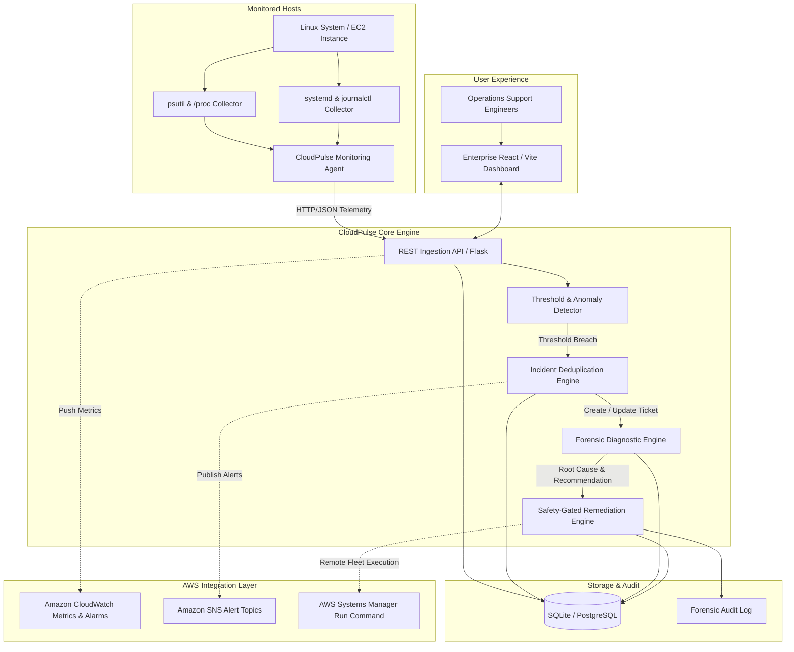
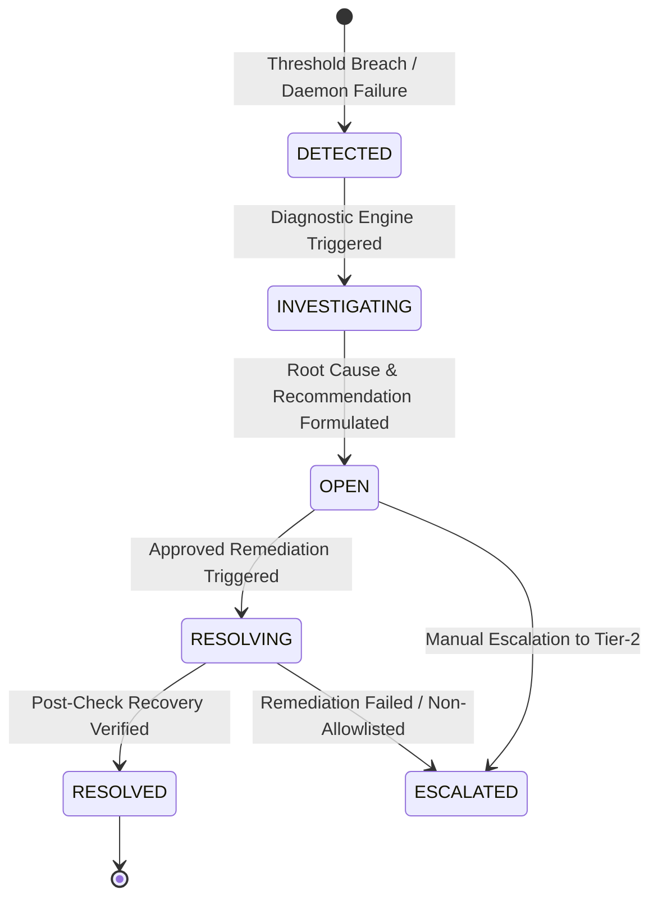

# CloudPulse Architecture & System Design

## 1. High-Level Architecture Overview

CloudPulse is an enterprise-grade infrastructure observability and automated incident response platform engineered for Linux environments and AWS cloud fleets.

---

## 2. Component Breakdown

### A. Linux Monitoring Agent (`agent/`)
- **SystemCollector**: Gathers physical & logical CPU utilization, per-core metrics, Unix load averages (`1m`, `5m`, `15m`), physical RAM and swap counters, mounted filesystem usage, and network interface I/O counters.
- **ProcessCollector**: Safely queries the OS process table using `psutil.process_iter()`, catching ephemeral process terminations (`NoSuchProcess`, `AccessDenied`), sorting top consumers by CPU and RSS memory.
- **ServiceCollector**: Interfaces directly with Linux `systemd` via `systemctl is-active`, `systemctl show`, and queries `journalctl` for recent failure logs. Emulates states when running on non-Linux development machines.
- **Telemetry Loop**: Serializes structured JSON and transmits to `POST /api/metrics`.

### B. Anomaly & Incident Deduplication Engine (`backend/app/services/incident_service.py`)
- Evaluates incoming time-series telemetry against configured warning and critical thresholds.
- Computes unique alert deduplication fingerprints: `dedup_key = {server_id}:{alert_type}:{affected_resource}`.
- If an active alert condition already exists, it updates timestamps and severity rather than flooding operators with alert storms.
- When metrics normalize, it initiates automated recovery verification and transitions the ticket to `RESOLVED`.

### C. Forensic Diagnostic Engine (`backend/app/diagnostics/`)
- Independent diagnostic modules:
  - `CPUDiagnostics`: isolates runaway process PIDs, CPU saturation, and load skew.
  - `MemoryDiagnostics`: inspects RAM pressure, buffer cache, and OOM-killer risks.
  - `DiskDiagnostics`: pinpoints large directory bloat safely with recursion bounds, finds large files, and checks inode depletion.
  - `ServiceDiagnostics`: parses journalctl error patterns (OOM kills, port collisions, syntax errors).
  - `NetworkDiagnostics`: verifies DNS latency, socket handshakes, and application health endpoints.
- Produces structured JSON diagnostic reports stored in the database.

### D. Safety-Gated Remediation Engine (`backend/app/remediation/`)
- Strict defense-in-depth security model:
  - Command allowlists (`ALLOWED_SERVICES`, `ALLOWED_TEMP_PATHS`).
  - Strict parameter validation (disallowing path traversal `..` or root `/`).
  - Snapshot pre-checks before execution.
  - Execution with bounded timeouts.
  - Post-checks verifying the actual system state recovered (e.g., service is active or disk reclaimed).
  - Forensic audit trail stored in `audit_logs`.

---

## 3. Incident Lifecycle State Machine

