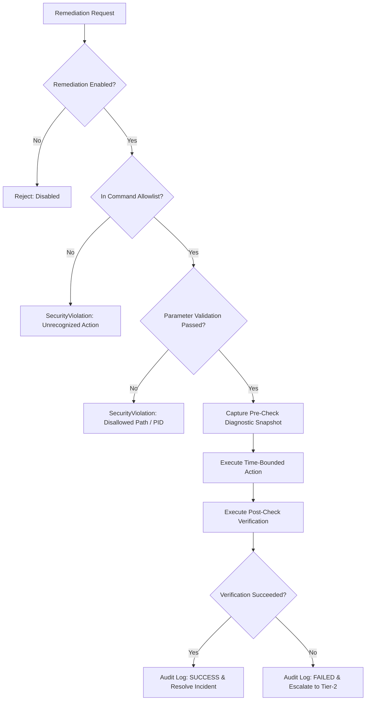

# CloudPulse Security Architecture & Remediation Controls

Automated remediation in enterprise cloud environments requires strict defense-in-depth to eliminate the risk of destructive actions, arbitrary code execution, or privilege escalation.

---

## 1. Automated Remediation Security Model

CloudPulse enforces non-negotiable security guardrails before any recovery command is executed:

### Key Security Principles

1. **Zero Arbitrary Shell Execution**: The engine does not accept raw bash strings from users, API clients, or agents. All operations are mapped to predefined, parameter-sanitized Python functions.
2. **Strict Command Allowlisting**:
   - `ALLOWED_SERVICES`: Only designated daemon services (`nginx`, `postgresql`, `redis`, `cloudpulse-worker`, `test-service`) can be restarted. Any attempt to restart unauthorized services throws a `SecurityViolation`.
   - `ALLOWED_TEMP_PATHS`: Only explicitly configured paths (e.g., `data/test_temp/`, `/tmp/cloudpulse_test/`) can be pruned.
3. **Directory Traversal Defense**: All target file and directory paths are canonicalized with `os.path.normpath` and `os.path.abspath`. Any path containing `..` or targeting outside the allowlisted boundary is immediately rejected.
4. **PID Safety Guardrails**:
   - PIDs $\le 100$ (kernel threads, system init, systemd) can never be terminated.
   - Only processes matching verified test names (`python`, `stress`, `node`) are terminable.
5. **Execution Timeouts**: Every subprocess execution is bounded with hard timeouts (5s to 15s) to prevent thread deadlocks.
6. **Immutable Forensic Audit Logging**: Every attempted, approved, succeeded, and rejected remediation action is permanently recorded in the `audit_logs` database table with operator identity and IP address.

---

## 2. AWS Least-Privilege & Credential Security

- **No Hardcoded Keys**: CloudPulse prohibits hardcoded `AWS_ACCESS_KEY_ID` or `AWS_SECRET_ACCESS_KEY` in code or version control.
- **IAM Roles & Instance Profiles**: In AWS environments, the application retrieves short-lived temporary STS credentials automatically via the attached IAM Role.
- **IMDSv2 Enforcement**: EC2 metadata discovery requires a secure session token (`X-aws-ec2-metadata-token`) to prevent SSRF vulnerabilities.
- **Network Isolation**: When deployed in AWS, CloudPulse backend instances run inside private subnets behind an Application Load Balancer and Security Groups.
